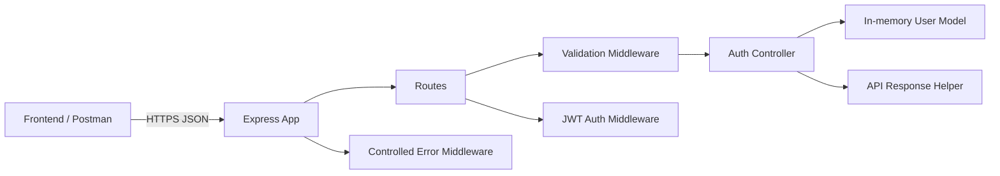

# Member 1 Backend Architecture

This diagram represents Member 1's backend foundation. MongoDB can replace the in-memory model in a later project stage without changing the route/controller separation.
